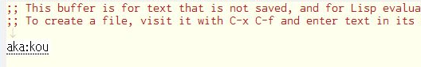
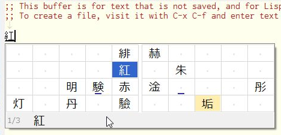
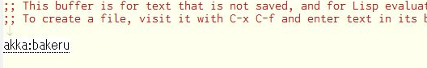
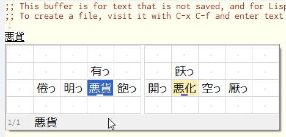
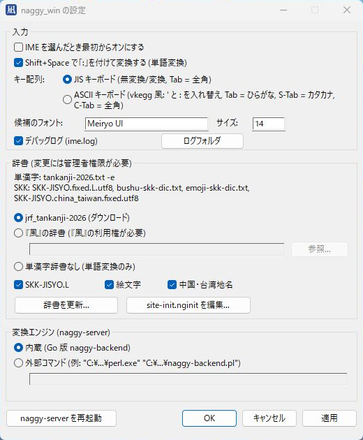

# naggy_win

<!-- Time-stamp: "2026-11-25T13:00:00Z" -->

単漢字変換 Input Method「Naggy」の Windows IME 版です。

[quail-naggy](https://github.com/JRF-2018/quail-naggy) (Emacs 用) の動きを
そのまま Windows の IME (Text Services Framework) にしたものと、
Perl なしで動く naggy-backend の Go 版からなります。

**状態: バージョン 0.3.7 (テスト中)。** naggy-backend (Go 版) は Perl 版と
の出力比較テストを通っていますが、IME 部分はまだ実機での確認が十分ではありま
せん。

## 画面

入力中はローマ字がそのまま表示されます。Space で変換すると、キーボードの
40 キーの配置に並んだ候補ウィンドウが出て、候補の位置のキーを押すと確定で
す (`f` と `j` の位置には小さな印があります)。

### 単漢字変換

`aka:kou` と入力して Space を押すと、「あか」と読む漢字が並び、「こう」とも
読む字 (紅・垢) が強調されます (黄色)。青い枠は今の候補です。





### 単語変換

大文字で始めた `Akka:bakeru` では、「あっか」と読む単語の候補が並び、「ばけ
る」(化ける) の字を含む「悪化」が強調されます。





### 設定ウィンドウ

タスクバーの「あ/A」の右クリック →「設定...」で開きます。



## 構成

| ファイル | 説明 |
|---|---|
| `naggy-backend(.exe)` | naggy-backend.pl の Go 版。標準入出力で同じプロトコルを話す。quail-naggy からもそのまま使える。 |
| `naggy-server.exe` | IME 用。セッションに一つ起動し、名前付きパイプで全アプリの IME に backend を共有させる。内蔵 Go 版のほか、Perl 版 naggy-backend.pl などの外部 backend への中継もできる。 |
| `System32\naggy_win\naggy_ime.dll`, `SysWOW64\naggy_win\naggy_ime.dll` | IME 本体 (TSF Text Input Processor)。64bit / 32bit アプリ用。 |
| `naggy-dictool.exe` | 辞書の準備 (ダウンロード・変換・`site-init.nginit` の作成)、『風』辞書の変換 (dic2txt.pl の移植) など。 |
| `naggy-config.exe` | 設定ウィンドウ。タスクバーの「あ/A」の右クリック →「設定...」、またはスタートメニューから開く。 |
| `naggy-client.exe` | naggy-server にコマンドを送るテスト用ツール。 |
| `nginit\`, `trl\`, `dic\bushu-skk-dic.txt` | quail-naggy 由来の初期化ファイル・変換表・部首辞書。 |

## インストール

`naggy_win-0.3.7-setup.exe` を実行します(管理者権限が必要です)。

途中で単漢字辞書を選びます。

* **jrf_tankanji-2026** (推奨): JRF が同人的に作成した単漢字辞書
  ([jrf_tankanji-2026](https://github.com/JRF-2018/jrf_tankanji-2026))を
  GitHub からダウンロードします。作成時に『風』の辞書を参考にした部分があり
  ます。作者(JRF)は利用を許可していますが、『風』が購入できる場合で、おためしを超
  えて使うなら『風』を購入してほしい、とのことです。
* **『風』の辞書**: 『風』の利用権をお持ちの方向け。インストール済みの『風』
  の `Wind2.rea` / `Wind2.dic`(または変換済みの `Wind2.txt`)を変換して使い
  ます。辞書はインストーラに含まれず、インターネットからも取得しません。
  Vector で入手した `Wind230.exe` の場合は、先にそれを実行して展開したフォル
  ダを指定してください。
* **単漢字辞書なし**: 単語変換 (SKK 辞書) のみ。

追加の辞書として SKK-JISYO.L (単語変換・しぼり込み用、GPL)、絵文字辞書
[naggy-emoji-skk-dic](https://github.com/JRF-2018/naggy-emoji-skk-dic)、
SKK-JISYO.china_taiwan をダウンロードできます。SKK-JISYO.L は quail-naggy の
`fix_skk_jisyo_l.pl` と同じ処理をして UTF-8 で保存されます。

インストール後、タスクバーの入力方式 (Win + Space) で「Naggy (単漢字変換)」
を選びます。出てこない場合は、設定 → 時刻と言語 → 言語 → 日本語 → オプショ
ン → キーボードの追加 で追加してください。

辞書や設定はインストール先の `site-init.nginit` と `dic\` にあります。辞書
を選び直すには、設定ウィンドウ (後述) の「辞書を更新...」を使うか、インスト
ーラを再実行するか、管理者権限で

```
naggy-dictool.exe setup --force --dest "C:\Program Files\naggy_win" --tankanji jrf
```

などとします(`naggy-dictool.exe` だけで使い方を表示します)。変更後はタスク
バーの「あ/A」を右クリックして「naggy-server 再読み込み」を選びます。

## 使い方

入力中は quail-naggy と同じく、ひらがなではなくローマ字 (ASCII) がそのまま
表示されます。入力後のキーで、何として確定するかを選びます。

### 入力中

| キー | 動作 |
|---|---|
| 半角/全角, Alt+` | IME オン/オフ |
| Space | 変換 (単漢字変換。`aka:kou` のようなしぼり込みや `Akka:bakeru` のような単語変換も quail-naggy と同じ) |
| Shift+Space | 末尾に `:` を付けて変換 (`nihon` → `nihon:` = 単語変換) |
| Ctrl+Space | 空白を入力 |
| Alt+Space | 直前に指定した方式 (`#greek` など) で変換 |
| Enter, F10, Ctrl+M | そのまま (半角英数で) 確定 |
| 無変換, F6, Shift+Enter | ひらがなで確定 |
| 変換, F7, Shift+Tab | カタカナで確定 |
| Shift+変換, F8 | 半角カタカナで確定 |
| Tab, F9, Ctrl+I | 全角英数で確定 |
| Esc, Ctrl+G | 入力を取り消し |
| Backspace/Delete, ←/→, Home/End (Ctrl+H/D/B/F/A/E) | 入力中の文字列を編集 |
| (入力がないとき) Shift+Space | 全角スペース |
| それ以外のキー | 入力をそのまま確定してから、そのキーをアプリに渡す |

`#` による方式指定 (`Abraam#greek`, `3042#u`, `kanji#k` など) も
quail-naggy と同じです。

### 変換中 (候補ウィンドウ表示中)

候補ウィンドウはキーボードの 40 キー (`1`〜`0`, `q`〜`p`, `a`〜`;`, `z`〜`/`)
の配置で並んでいます (キーの文字は表示しません。`f` と `j` の位置に小さな印が
あります)。キーは物理的な位置で判定するので、JIS キーボードで文字の出ない
Shift+0 でも「0」の位置の候補を一時選択できます。

| キー | 動作 |
|---|---|
| 候補の位置のキー | その候補で確定 |
| Shift(または Alt) + 候補の位置のキー | その候補を一時的に選択 (後ろの文字やコメントを確認) |
| Space, PageDown | 次のページ |
| Backspace, Delete, PageUp, Shift+Space, Ctrl+H | 前のページ (最初のページで押すと変換取り消し) |
| ↑↓←→ (Ctrl+P/N/B/F) | 仮想鍵盤上でカーソル移動 |
| Enter | 選択中の候補で確定 |
| Esc, Ctrl+G | 変換を取り消して入力に戻る |
| 無変換/変換/Tab/F6〜F10 など | 元の文字列をひらがな等で確定 |
| マウス左クリック / 右クリック | 確定 / 一時選択 |
| その他のキー | 変換を取り消して、そのキーを入力として扱う |

### ASCII キーボード (vkegg 風) のキー配列

設定ウィンドウで「ASCII キーボード」を選ぶと、vkegg.el の ASCII 配列用の設
定と同様に、

* `'` (`;` の右のキー) で `:` を、`:` (Shift+;) で `'` を入力
* Tab でひらがな、Shift+Tab (または Alt+Tab) でカタカナ、Ctrl+Tab で全角英数

になります (無変換・変換・F6〜F10 はそのまま使えます)。

## 設定

タスクバーの「あ/A」を右クリックして「設定...」を選ぶと設定ウィンドウが開き
ます (スタートメニューの「naggy_win の設定」からも開けます)。

* 入力: 最初からオンにするか (既定はオフ)、Shift+Space の動作、キー配列 (JIS / ASCII)、候補ウィ
  ンドウのフォント、デバッグログ。「適用」で、開いているアプリにも次のキー
  入力から反映されます。
* 辞書: 単漢字辞書 (jrf_tankanji-2026 /『風』/ なし) と追加辞書を選んで「辞
  書を更新...」(管理者権限の確認が出ます)。終わると naggy-server が辞書を読
  み直します。「site-init.nginit を編集...」で初期化ファイルを直接編集できま
  す。
* 変換エンジン: 内蔵 (Go 版) か、外部コマンド (Perl 版 naggy-backend.pl な
  ど)。変更すると naggy-server を再起動します。

設定ウィンドウが書き込むレジストリ値は
`HKEY_CURRENT_USER\Software\naggy_win` (なければ `HKEY_LOCAL_MACHINE`) の次
の値です:

| 名前 | 型 | 既定 | 説明 |
|---|---|---|---|
| `StartOpen` | DWORD | 0 | 1 にすると IME を選んだとき最初からオン (既定はオフで始まる) |
| `ShiftSpaceAltConvert` | DWORD | 1 | Shift+Space で `:` 付き変換 (0 なら空白入力) |
| `FontName` | 文字列 | Meiryo UI | 候補ウィンドウのフォント |
| `FontSize` | DWORD | 14 | 候補ウィンドウのフォントサイズ (pt) |
| `KeyLayout` | DWORD | 0 | 0: JIS キーボード、1: ASCII キーボード (vkegg 風) |
| `DebugLog` | DWORD | 0 | 1 で `%LOCALAPPDATA%\naggy_win\ime.log` にログを書く |
| `ServerPath` | 文字列 | | naggy-server.exe の場所 (通常は不要) |

naggy-server の設定は `naggy-server.ini` (インストール先、または
`%APPDATA%\naggy_win\`)。`naggy-server.ini.sample` を参照してください。
naggy-server は `%APPDATA%\naggy_win\` を、naggy-backend と同様
`%USERPROFILE%\.naggy-backend` を、初期化ファイルや辞書の検索パスの先頭に
加えます。ログは `%LOCALAPPDATA%\naggy_win\naggy-server.log` です。

### Perl 版 naggy-backend.pl を使う

`naggy-server.ini` に

```
backend = "C:\Strawberry\perl\bin\perl.exe" "C:\home\me\elisp\quail-naggy\naggy-backend.pl"
define = FRONT_END=quail-naggy
```

のように書くと、IME の変換に Perl 版を使います。(naggy_win 付属の
`default-init.nginit` は `FRONT_END=naggy_win` を quail-naggy と同様に扱い
ますが、従来の `default-init.nginit` では `FRONT_END=quail-naggy` の指定が
必要です。)

## Go 版 naggy-backend を使う (quail-naggy (Emacs) からも使える)

`naggy-backend.exe` (Linux などでは `naggy-backend`) は単体の実行ファイル
で、どこに置いても動きます。naggy-backend.pl と同様、初期化ファイル
(`site-init.nginit`)・変換表・辞書は、**実行ファイルが置かれたディレクトリ**
(とその下の `trl\`, `nginit\`, `dic\`)から探します (その前に
`~/.naggy-backend` (ファイルなら初期化ファイル、ディレクトリなら検索先) も
見ます。`-I DIR` で検索先を追加、`--input-file FILE` で初期化ファイルを指定
できます)。起動したときのカレントディレクトリは関係ありません。

例えば `naggy-backend.exe` を `naggy-backend.pl` と同じディレクトリに置き、

```elisp
(setq naggy-backend-program "C:/path/to/quail-naggy/naggy-backend.exe")
(setq naggy-backend-options nil)
```

とします。Perl、Unicode::Japanese、`*.sdb.dir` / `*.sdb.pag` (SDBM インデッ
クス) は不要です(辞書は起動時にメモリ上で索引を作ります)。初期化ファイル、
変換表、辞書、コマンドライン・オプションは Perl 版と同じものが使えます。

Perl 版との違い:

* euc-jisx0213 の辞書を正しく読みます。Perl の `euc-jp` では「か゚」のよう
  な合成文字 (25 字) や JIS X 0213:2004 の追加字が U+FFFD (�) になります
  が、Go 版では正しく表示され、単漢字辞書の 1 マスとして扱われます。
* SDBM インデックスが不要。インデックスを作り直す必要もありません。
* `version` は `0.18-naggy_win-0.3.7` を返します。
* `rename-translit`, `read-with-encoding-e` (unsafe) の Perl 版にあるバグ
  は直してあります。

他のプラットフォーム用には `GOOS=linux GOARCH=amd64 go build ./cmd/naggy-backend`
などでビルドできます(外部ライブラリ不要)。

## 既知の制限

* Emacs にフォーカスがあるとき、タスクバーの「あ/A」の右クリックメニューが
  出ないことがあります (一度ほかの IME に切り換えて戻すと出ます)。設定はス
  タートメニューの「naggy_win の設定」からも開けます。

* ウイルス対策ソフトがらみで問題が出ることがあります。例えば作者のところで
  は、ESET の「バンキング&ブラウジング保護」で「すべてのブラウザーを保護」
  が有効だと、Firefox / Chrome / Edge に naggy_win の DLL が読み込まれず、
  ブラウザでは使えませんでした (DLL に署名がないためと思われます)。保護を止
  めるか、保護の対象を専用ブラウザに限定するなどの設定が必要です。

* Emacs など IMM32 のアプリでは、Windows の互換機能 (CUAS) 経由で動くため、
  入力中の文字列がアプリ内ではなく別の小窓に表示されることがあります。Emacs
  では quail-naggy (Go 版 naggy-backend 付き) を使うのがおすすめです。

* UI レスモード (全画面ゲームなどで IME が候補ウィンドウを描かないモード)
  には対応していません。
* 再変換、学習、ユーザー辞書の登録はありません (quail-naggy と同じ)。
* ARM64 版 DLL はまだありません。
* AppContainer (ストアアプリ) からは naggy-server を起動できないため、ロ
  グオン時に自動起動します(インストーラが設定)。

## うまく動かないとき

設定ウィンドウで「デバッグログ」をオンにして「適用」し、問題のアプリで入力し
てみてください。`%LOCALAPPDATA%\naggy_win\ime.log` にキー入力や文書の更新
の様子が記録されます (naggy-server のログは同じフォルダの
`naggy-server.log`)。

## ビルド

[BUILD.md](BUILD.md) を参照してください。

## 作者 (文責)

JRF ( http://jrf.cocolog-nifty.com/statuses , Twitter (X): @jion_rockford )

Naggy の単漢字変換のやり方は、冨樫雅文さんの単漢字変換 IME『風』を受け継い
だものです。それを Emacs 上に実装した quail-naggy・naggy-backend.pl は JRF
のもの(AI 以前のもの)です。naggy-backend の Go への移植、Windows IME (TSF)
とインストーラの設計・プログラムは Claude Opus 5.5 (Anthropic) によるもので、
JRF はテストと仕様の指示を行いました。

## ライセンス

MIT License ([LICENSE](LICENSE))。ダウンロードされる辞書はそれぞれのライセ
ンスに従います。

----
(This document is mainly written in Japanese/UTF8.)
